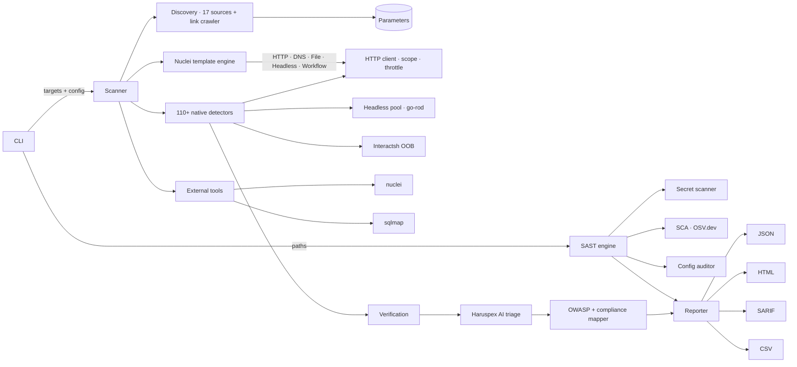

# assay — context-aware web vulnerability assay

[](go.mod)
[](https://goreportcard.com/report/github.com/TyrusRC/assay)
[](LICENSE)
[](https://github.com/TyrusRC/assay/commits/main)
[](https://github.com/TyrusRC/assay/issues)
[](#contributing)

A Go-native, CLI web-application security scanner that combines **110+
context-aware native detectors**, a **Nuclei-compatible template engine
with full protocol parity**, optional **upstream tool integrations**
(Nuclei binary, SQLMap), a **headless-browser pool** for DOM- and
origin-aware checks, and a **native SAST engine** (secret scanning, SCA,
config audits). Findings are mapped to OWASP **WSTG**, **Top 10 (2025)**,
**API Security Top 10**, and compliance frameworks (**PCI DSS**, **HIPAA**,
**SOC 2**).

assay focuses on the categories Nuclei templates structurally cannot
reach — stateful business-logic bugs, two-identity IDOR/BOLA, race
conditions over raw HTTP/2 frames, postMessage origin validation,
authenticated cache deception, and more — while reusing the upstream
Nuclei community template store for everything Nuclei already does
well.

> **Status:** pre-1.0. Detector defaults and the CLI surface may still
> shift between minor versions — pin a tag or commit if you depend on
> exact behavior.

### Highlights

- **Multi-technique SQL injection** — error-based, boolean-blind, UNION-based (binary-search column detection, multi-DB fingerprint), response-differential (catches custom JSON error wrappers), time-based blind, and **error-differential** (status-code change on metacharacter, e.g. 200→500 on `'`). Location-aware: works on query, JSON body, XML body, path, header, and cookie params. Length-ratio similarity catches table-heavy differentials that set-based Jaccard misses.
- **OpenAPI-first API scanning** — YAML + JSON spec parsing, requestBody property extraction, sibling body-param injection (sends all fields so multi-field endpoints reach the SQL layer), per-endpoint method + URL routing.
- **Command injection** — output-pattern detection (Linux + Windows), time-based blind, and **error-differential** (status-code change on command separators `;`, `|`, `` ` ``). Catches blind CMDI where output is suppressed.
- **Code injection detection** — raw eval()/exec() detection via arithmetic probes (catches Python eval, Node vm, Ruby eval) alongside template-engine SSTI.
- **XXE with body replacement** — for XML-accepting endpoints, sends the full DOCTYPE + entity declaration as the request body with the correct element name from the API schema.
- **XSS with executable-context verification** — reflected XSS payloads are checked for unencoded dangerous characters (`<`, `>`, `"`, `'`) at the reflection point. Filters out HTML-encoded reflections that appear reflected but are not executable.
- **Link-crawling discovery** — BFS crawl of same-origin pages (default 30), runs all 17 discoverers on each page. Finds form params, hidden inputs, and endpoints on subpages that a root-only fetch misses. Form `action` attributes are resolved to correct endpoint URLs. Query params from crawled link URLs are extracted at zero HTTP cost.
- **JS endpoint extraction** — parses `fetch()`, `axios.post()`, `$.ajax()`, and `$.post()` patterns in inline and external JavaScript to discover POST body params with JSON content type. Catches SPA/AJAX endpoints invisible to HTML-only discovery.
- **Reflected-parameter brute-forcer** — probes ~65 common param names via GET, POST form-urlencoded, and POST JSON on the root page. Detects hidden params via value reflection or body-size change.
- **Content-type negotiation** — during param classification, if form-urlencoded POST returns 500, automatically retries with JSON. Tags the param so all subsequent probes use the correct encoding.
- **Type-aware sibling defaults** — multi-field forms send realistic values for sibling params (numeric IDs, email format, password format, booleans) instead of a generic "test" that fails validation.
- **Parallel detector pipeline** — configurable param concurrency (default 5) and per-param detector concurrency (default 3). Spec-discovered params run before generic built-in headers. Param cap (default 200) prevents multi-hour scans on large apps.
- **Stored XSS** — full inject → crawl → match → confirm workflow
- **Native SAST** — `assay sast ./src` for secret scanning, dependency CVEs (OSV.dev), and config security
- **Form auto-submission** — smart crawl discovers pages behind form gates (`--submit-forms`)
- **Auto template discovery** — loads `~/nuclei-templates` + `~/.local/share/assay/custom-nuclei-templates/templates` by default. Override with `--templates` or `ASSAY_TEMPLATES` env.
- **Nuclei template parity** — 20 headless actions, file / workflow / code templates, unsafe-raw (smuggling), pipeline (HTTP/2 desync), interactsh OOB polling
- **AI finding triage** — Haruspex adjudication scores each finding's "real vs noise" probability
- **Risk-gated payloads** — destructive SQL payloads (`DROP TABLE`, `xp_cmdshell`) require `--risk 3`
- **Incremental results** — findings flush to disk after each scan phase, so early results survive if a later phase times out
- **Authenticated API server** — `assay serve` with bearer-token auth, SSRF protection, concurrent scan limits

---

## Table of contents

- [Why assay](#why-assay)
- [Quickstart](#quickstart)
- [Installation](#installation)
- [Usage](#usage)
- [Detection coverage (DAST)](#detection-coverage-dast)
- [Static analysis (SAST)](#static-analysis-sast)
- [API server](#api-server)
- [Headless / two-identity probes](#headless--two-identity-probes)
- [External tool integrations](#external-tool-integrations)
- [CI/CD integration](#cicd-integration)
- [How assay compares](#how-assay-compares)
- [Architecture](#architecture)
- [Project layout](#project-layout)
- [Development](#development)
- [Contributing](#contributing)
- [Security policy](#security-policy)
- [License](#license)

---

## Why assay

A scanner is only as good as the categories it can express. Nuclei is
excellent at fingerprint / CVE / regex-on-response checks, but it has
no JavaScript runtime, no session model, and no way to compare
behavior across two authenticated identities. assay fills exactly that
gap:

- **Two-identity IDOR / BOLA.** Probe the same URL with two different
  auth states and report when user A's response leaks to user B.
- **Race conditions** with H/1 last-byte synchronisation and H/2
  single-packet bursts (CVE-2023-44487-style raw-frame control).
- **Web cache deception** with optional unauthenticated replay
  verification.
- **Authenticated postMessage origin probe** that dispatches a
  synthetic `MessageEvent` from an attacker origin and watches which
  DOM/storage sinks the page's listeners mutated.
- **Smuggling, JWT cryptanalysis, OAuth/OIDC, GraphQL introspection,
  OpenAPI spec runner, second-order injection** — all stateful,
  multi-request flows.
- **Location-aware payload dispatch** (`SendPayloadAt`): JSON body,
  multipart, XML, path segment, header, and cookie injection points
  discovered by the auto-discovery pipeline are tested in the right
  transport, not silently shoved into the query string.

assay **runs Nuclei alongside** itself when the binary is on `PATH` —
you do not have to choose between the two.

---

## Quickstart

```sh
# install (Go 1.24+)
go install -v github.com/TyrusRC/assay/cmd/assay@latest

# DAST — scan a single URL
assay scan https://example.com/page?id=1

# DAST — thorough scan with stored XSS and form submission
assay scan --profile thorough --stored-xss --submit-forms https://app.example.com

# DAST — authenticated scan with session keep-alive
assay scan --login-url https://app.example.com/login \
  --login-user admin --login-pass "$ASSAY_LOGIN_PASS" \
  --login-success "Dashboard" https://app.example.com/admin

# DAST — two-identity IDOR / BOLA probe
assay scan https://app.example.com/account/123 \
  --auth-a-header "Authorization: Bearer alice-token" \
  --auth-b-header "Authorization: Bearer bob-token"

# DAST — proxy through Burp Suite
assay scan -X POST -d "user=admin&pass=test" \
  --proxy http://127.0.0.1:8080 -k https://example.com/login

# SAST — scan a codebase for secrets, vulnerable dependencies, config issues
assay sast ./my-project
assay sast --sca-only ./  # dependency CVEs only

# API server
assay serve --api-key "$ASSAY_API_KEY"
# POST http://127.0.0.1:8080/api/scans  {"target":"https://example.com"}

# CI/CD gate
assay scan "$TARGET" --format sarif,junit --fail-on high --output-dir report
```

---

## Installation

### `go install` (recommended)

```sh
go install -v github.com/TyrusRC/assay/cmd/assay@latest
```

### From source

```sh
git clone https://github.com/TyrusRC/assay.git
cd assay
make build       # produces ./bin/assay
make install     # optional: install into $GOBIN
```

### Docker

```sh
docker build -t assay .
docker run --rm assay scan https://example.com
```

### Requirements

- **Go 1.24+** to build from source.
- *(optional)* a Chromium-based browser for DOM-aware detectors and
  the postMessage probe — `go-rod` auto-downloads one on first use,
  or pass `--chrome-path` to use a system binary.
- *(optional)* `nuclei` and/or `sqlmap` on `PATH` to enable the
  external-tool wrappers. assay degrades gracefully when they are
  missing.

---

## Usage

```text
assay scan [target URL] [flags]
```

### Targets

- positional argument: `assay scan https://example.com`
- target list file: `assay scan -l targets.txt`
- piped from stdin: `cat targets.txt | assay scan`

### Authentication & transport

| Flag | Description |
|---|---|
| `-H, --header KEY:VAL` | Custom request header (repeatable) |
| `--cookie STRING` | `Cookie:` header value |
| `-A, --user-agent UA` | Custom User-Agent for ALL scanner traffic |
| `--proxy URL` | Proxy URL (HTTP CONNECT honored — Burp Suite friendly) |
| `-k, --insecure` | Skip TLS verification (needed when Burp/MitM uses its own CA) |
| `-d, --data STRING` | POST body (form-urlencoded by default) |
| `-X, --method METHOD` | HTTP method (default `GET`) |
| `--login-url URL` | Login page URL for form-based authentication |
| `--login-user USER` | Login username |
| `--login-pass PASS` | Login password (prefer `ASSAY_LOGIN_PASS` env var) |
| `--login-headless` | Use headless browser for login (SPAs, JS-rendered forms) |
| `--login-success STRING` | Marker string in post-login response confirming success |

### Scan shaping

| Flag | Description | Default |
|---|---|---|
| `-t, --timeout DURATION` | Total scan timeout | `30m` |
| `-c, --concurrency N` | Concurrent tools | `3` |
| `--profile NAME` | Scan profile (`quick`, `normal`, `thorough`) | |
| `--level 1-5` | SQLMap-style level | `1` |
| `--risk 1-3` | SQLMap-style risk | `1` |
| `--templates DIR` | Nuclei-style template dir/file; **repeatable** — pass once per path to load the default store and custom templates together (e.g. `--templates ~/nuclei-templates --templates ~/custom-nuclei-templates`) | |
| `--api-spec URL` | OpenAPI/Swagger JSON; runner exercises every endpoint | |
| `--stored-xss` | Enable stored XSS detection (auto at `--level 3+`) | off |
| `--submit-forms` | Submit discovered forms during crawl to find gated pages | off |
| `--format LIST` | Output formats: `json`, `html`, `markdown`, `csv`, `sarif`, `junit`, `gitlab` (comma-separated) | `json` |
| `--fail-on SEVERITY` | Exit code 2 when findings meet or exceed this severity | |
| `--fail-on-new` | Gate only on findings absent from `--baseline` | off |
| `--baseline FILE` | Previous scan JSON; diff-only for incremental scanning | |

### Template decision engine (the Jev pattern)

Rank the loaded templates by relevance to the target's detected tech before the
run — the "Jev for nuclei" idea. Env-driven, opt-in, two backends:

| Env | Effect |
|---|---|
| `ASSAY_DECIDE=1` | Enable the decision engine (deterministic tech-tag ranking, no key). |
| `AI_GATEWAY_API_KEY` | Use TypeSafe **Jev** via Vercel AI Gateway (`POST /v1/evaluate`, calibrated per-template relevance). Enables the engine on its own; falls back to deterministic on any gateway error. |
| `ASSAY_DECISION_BASE_URL=http://127.0.0.1:PORT` | Use a **self-hosted** decision engine (e.g. Haruspex / OpenJev) on loopback — same `/v1/evaluate` contract, selected **keyless** (the key authenticates the remote gateway only). Enables the engine on its own. |
| `ASSAY_DECIDE_TOP=N` | Run only the N most relevant templates (operator cap to cut the firehose). Default `0` = order only, no drop. |
| `ASSAY_DECISION_MODEL` / `ASSAY_DECISION_BASE_URL` | Override the model id / gateway base URL (defaults `typesafe-ai/jev` / `https://ai-gateway.vercel.sh`). |

Disabled by default — the template set is untouched unless you opt in.

### Scope & rate (DAST)

Scope is **ON by default**: traffic is restricted to the target host(s) and
session-destroying paths (`/logout`, `/delete-account`, …) are skipped, so a scan
never wanders off-target. Every outbound request is gated at the HTTP client and
out-of-scope redirects are returned unfollowed. Cross-host detectors (cloud,
subdomain-takeover, the npm registry) and OOB callbacks use a separate unscoped
client, so they still reach their infrastructure. Use `--no-scope` to disable, or
`--scope-host` to broaden.

| Flag | Description | Default |
|---|---|---|
| `--no-scope` | Disable scope entirely (request any host) | off (scope on) |
| `--scope-host HOST` | Override the scoped hosts (repeatable; `*.example.com`) | target host(s) |
| `--include-path RE` | Only request paths matching one of these regexps (repeatable) | |
| `--exclude-path RE` | Never request paths matching these regexps (exclude wins) | |
| `--no-default-excludes` | Keep session-destroying paths (`/logout`, `/delete-account`, …) in scope | off |
| `--rate N` | Cap outbound requests per second across the whole scan | unlimited |

### Session keep-alive

When a login is performed (`--login-*`), the session is polled during the scan
and re-authenticated on logout, so authenticated probes do not silently become
unauthenticated.

| Flag | Description | Default |
|---|---|---|
| `--session-check-url URL` | Authenticated-only URL polled for logout | first target |
| `--session-check-interval D` | Poll cadence | `1m` |

`--login-success` doubles as the authenticated marker.

### Resume

| Flag | Description |
|---|---|
| `--checkpoint FILE` | Record per-target progress so an interrupted scan can resume |
| `--resume FILE` | Skip already-scanned targets and carry their findings forward |

### Output

| Flag | Description |
|---|---|
| `--json` | JSON to stdout (shorthand for `--format json`) |
| `--html` | HTML report to stdout (shorthand for `--format html`) |
| `--format LIST` | Comma-separated: `json`, `html`, `markdown`, `csv`, `sarif`, `junit`, `gitlab` |
| `--output-dir PATH` | Output directory for report files |
| `-v, --verbose` | Verbose progress on stderr |
| `--verify` | Re-test each finding to confirm (reduces false positives) |

### Two-identity IDOR / BOLA

| Flag | Description |
|---|---|
| `--auth-a-cookie STRING` | Cookie header for identity A (the "victim") |
| `--auth-b-cookie STRING` | Cookie header for identity B (the "attacker") |
| `--auth-a-header KEY:VAL` | Per-identity-A header (repeatable) |
| `--auth-b-header KEY:VAL` | Per-identity-B header (repeatable) |
| `--idor-url URL` | Override URL for the cross-identity probe |

### External tools

| Flag | Description |
|---|---|
| `--no-nuclei` | Skip the Nuclei binary even when it's on `PATH` |
| `--nuclei-tags LIST` | Tag filter forwarded to Nuclei (`cve,rce`) |
| `--nuclei-severity LIST` | Severity filter (`high,critical`) |

### Headless / DOM

| Flag | Description |
|---|---|
| `--chrome-path PATH` | Explicit Chrome/Chromium binary |
| `--storage-inj` | Enable client-side storage injection probes |
| `--no-postmessage` | Disable the postMessage origin-validation probe |

The SPA crawl captures XHR/fetch endpoints (via CDP network events) and
client-side routes registered through the History API (pushState/replaceState/
popstate), not just static anchors — so dynamic API surface is discovered.

### Per-detector toggles

Disable any detector with `--no-<name>`. Highlights:

`--no-csrf`, `--no-tabnabbing`, `--no-jsdep`, `--no-data-exposure`,
`--no-admin-path`, `--no-api-version`, `--no-content-type`, `--no-sse`,
`--no-grpc-reflect`, `--no-prompt-injection`, `--no-xslt`,
`--no-saml-injection`, `--no-orm-leak`, `--no-type-juggling`,
`--no-dep-confusion`, `--no-token-entropy`, `--no-cache-deception`,
`--no-cache-poisoning`, `--no-css-injection`, `--no-deserialization`,
`--no-dom-clobber`, `--no-email-injection`, `--no-hpp`,
`--no-html-injection`, `--no-second-order`, `--no-ssi`, `--no-storage`,
`--no-discovery`, `--no-oob`.

Aggressive probes are **opt-in** (mutate state or send heavy traffic):

`--rate-limit`, `--redos`, `--h2-reset`, `--mass-assign`,
`--proto-pollution-server`.

`--nvd-api-key KEY` (or `NVD_API_KEY` env) raises the NVD CVE lookup
limit from ~5 to ~50 requests / 30 seconds for the JS-dependency
detector.

---

## Detection coverage (DAST)

110+ native detectors mapped to OWASP WSTG / Top 10 / API Top 10 / CWE.
Each finding ships with all four mappings plus CVSS scoring.

### Injection
SQLi (**error-based + boolean-blind + UNION-based + time-based + stacked
+ out-of-band**), XSS (reflected + **stored** via inject-crawl-confirm +
DOM-based + blind/OOB), CMDi (error + time + OOB), SSTI (multi-engine —
Jinja2 / Twig / Freemarker / Velocity / Mako / Smarty / ERB / Java),
CSTI, NoSQL (error + boolean + time), LDAP, XPath, XXE (error + blind/OOB),
JNDI / Log4Shell, SSI, XSLT, SAML (XSW + comment injection), email-header,
CSV / formula, log injection, HTML / CSS / DOM-clobber injection.

### File handling
LFI (with PHP wrappers), RFI, file upload (MIME / double-ext /
null-byte bypass).

### Server-side
SSRF with cloud-metadata for AWS / Azure / GCP / Alibaba / Tencent /
IBM / Oracle / IPv6, HTTP request smuggling, **HTTP/2 desync**,
**HTTP/2 advanced (CONTINUATION flood)**, **HTTP/3 desync**, race
conditions (H/1 last-byte sync + H/2 single-packet), HTTP/2 rapid-reset
(CVE-2023-44487, opt-in), second-order injection, deserialization,
**padding oracle**.

### Auth & access
JWT cryptanalysis (alg=none / RS→HS / embedded JWK / kid traversal /
lifetime / weak-secret dict), **JKU abuse**, OAuth/OIDC discovery audit,
**OAuth flow testing**, **two-identity IDOR / BOLA**, single-identity
IDOR with numeric / UUID / hex mutation, **BAC (broken access control)**,
**403 bypass** (path normalization + verb tamper + header tricks), CORS,
mass-assignment with re-fetch verification, CSRF, **session fixation**,
**session lifecycle** (timeout / concurrent / invalidation), **MFA bypass**,
**password reset flow audit**, **PHP type-juggling auth bypass**,
**long-password DoS**, **SameSite cookie analysis**, **cookie tossing**.

### Cache
Web cache deception with unauth-replay verification, web cache
poisoning via unkeyed-header reflection, **cache key manipulation**.

### Headers / protocol
Security headers, open redirect, CRLF, header injection,
host-header reflection, WebSocket (CSWSH / reflection),
Server-Sent Events auth, gRPC reflection, TLS configuration,
reverse-tabnabbing, **XS-Leaks**, **ESI injection**, **X-Frame-Options /
clickjacking**.

### Config / exposure
Sensitive file exposure, cloud misconfig, subdomain takeover,
DOM clobbering, server-side prototype pollution (opt-in), HPP,
admin / debug path probe, content-type confusion, stack trace / debug
info, **data exposure**, **webhook signature validation**.

### API surfaces
OpenAPI spec runner (auth-bypass + undocumented verbs), **OpenAPI
semantic analysis**, API version enumeration, ORM expansion / over-fetch,
rate-limit burst probe (opt-in), GraphQL (introspection / alias batching /
depth bomb / field suggestion / **advanced injection**).

### DOM-aware (headless)
DOM-XSS, client-side prototype pollution, DOM-based open redirect,
client storage injection, **postMessage origin validation**,
**CSPT (client-side path traversal with JS taint tracking)**.

### Supply chain
JS dependencies parsed from `<script src>` queried against
[NVD CVE API](https://nvd.nist.gov/developers/vulnerabilities),
**dependency confusion** manifest leak, **subdomain takeover**.

### Modern / niche
LLM prompt injection, ReDoS timing probe (opt-in), insecure-token
entropy / sequential-id detector, **DNS rebinding**.

### Out-of-band
Blind detection via shared
[interactsh](https://github.com/projectdiscovery/interactsh) callback
server — XXE, SSRF, CMDI, RFI, XSS (blind), second-order all participate.

---

## Static analysis (SAST)

```sh
assay sast [path] [flags]
```

assay includes a native static-analysis engine for source-code and
configuration auditing. It runs independently of the DAST scanner and
produces findings in the same unified format.

### Secret scanning

15 pre-compiled regex patterns detect hardcoded credentials in source
files: AWS access keys, AWS secret keys, GitHub / GitLab / Slack / Stripe /
Google / Heroku tokens, JWTs, private keys (`-----BEGIN ... PRIVATE KEY-----`),
generic API keys and passwords in config, and database connection strings
(MongoDB / PostgreSQL / MySQL / Redis / AMQP). Evidence is auto-redacted in
findings.

### Software Composition Analysis (SCA)

Parses 8 manifest formats — `package.json`, `package-lock.json`, `go.mod`,
`requirements.txt`, `Pipfile.lock`, `Gemfile.lock`, `composer.lock`,
`pom.xml` — and queries the [OSV.dev](https://osv.dev/) batch API for known
CVEs. Findings include CVE IDs, severity, affected version ranges, and fix
versions.

### Configuration security

Detects security issues in common config files: secrets in `.env` files,
`Dockerfile` running as root (no `USER` directive), `docker-compose.yml`
with `privileged: true` or `network_mode: host`, `nginx.conf` with
`server_tokens on`.

### Flags

| Flag | Description | Default |
|---|---|---|
| `--secrets-only` | Run only secret scanning | off |
| `--sca-only` | Run only dependency CVE scanning | off |
| `--config-only` | Run only config security checks | off |
| `--exclude-dirs LIST` | Skip directories (comma-separated) | `vendor,node_modules,.git` |
| `--concurrency N` | Concurrent file scanning workers | `10` |
| `--fail-on SEVERITY` | Exit code 2 on findings at or above this severity | |
| `--format LIST` | Output formats (`json`, `html`, `markdown`, `csv`) | `json` |
| `--output-dir PATH` | Write reports to this directory | |

---

## API server

```sh
assay serve [flags]
```

Run assay as an HTTP API for programmatic scan management.

| Flag | Description | Default |
|---|---|---|
| `--port N` | Listen port | `8080` |
| `--listen ADDR` | Bind address | `127.0.0.1` |
| `--api-key KEY` | Bearer token for API authentication (also `ASSAY_API_KEY` env) | |

### Endpoints

| Method | Path | Description |
|---|---|---|
| `GET` | `/api/health` | Health check (no auth required) |
| `POST` | `/api/scans` | Create a new scan (`{"target":"https://..."}`) |
| `GET` | `/api/scans` | List scans (paginated: `?offset=0&limit=25`) |
| `GET` | `/api/scans/{id}` | Get scan status and findings |
| `GET` | `/api/scans/{id}/report?format=json` | Download report |

### Security

- Binds to `127.0.0.1` by default — pass `--listen 0.0.0.0:8080` to
  expose externally.
- When `--api-key` is set, all endpoints except `/api/health` require
  `Authorization: Bearer <key>` (constant-time comparison).
- Scan targets are validated: `http`/`https` only, private/loopback
  IPs rejected (SSRF protection with IPv6-mapped IPv4 normalization).
- Concurrent scans are limited to 3 by default.
- Job store evicts oldest completed jobs after 1000 entries.
- A bundled web dashboard is served at `/` when the embedded SPA assets
  are present.

---

## Headless / two-identity probes

Two capabilities deserve special call-out because they are
structurally beyond Nuclei templates:

### `postMessage` origin probe
Navigates a target in a real browser, dispatches a synthetic
`MessageEvent` claiming an attacker origin, then diffs DOM / storage
sinks. Listeners that mutated `innerHTML` / `location` / `localStorage`
/ `sessionStorage` / `documentCookie` without validating
`event.origin` are reported with severity graded by which sink
was reached.

```sh
assay scan --no-postmessage=false https://app.example.com/
```

### Two-identity IDOR / BOLA
Constructs two HTTP clients carrying distinct auth state and probes
the same URL with each. When identity B's response carries a body
similar (Jaccard ≥ 0.85) to identity A's private response — and
contains sensitive-data markers — emit a Critical finding. Otherwise
High when the unauthorised access is confirmed, Medium when only the
application precondition is observed.

```sh
assay scan https://api.example.com/v1/users/42 \
  --auth-a-cookie "session=alice" \
  --auth-b-cookie "session=bob"
```

---

## External tool integrations

assay ships in-process implementations for everything in
[Detection coverage](#detection-coverage-dast) plus a **built-in Nuclei-compatible
template engine** with full protocol parity (HTTP, DNS, Network, SSL,
WebSocket, WHOIS, Headless with 20 actions, File, Workflow). The external
wrappers are opt-in additions for breadth.

| Tool | Status | Purpose |
|---|---|---|
| **Built-in template engine** | native (`internal/templates`) | Nuclei-compatible: all protocols, unsafe-raw (smuggling), pipeline (HTTP/2 desync), interactsh OOB, 20 headless actions |
| **Nuclei** | wrapped (`internal/tools/nuclei`) | Runs upstream community templates (15,000+) with `-jsonl`; findings parsed into the unified report |
| **SQLMap** | wrapped (`internal/tools/sqlmap`) | Deep SQL-injection exploitation when in-process UNION / boolean / time-based isn't enough |

`assay tools list` shows availability and version of each. `assay tools
check` runs a health check and prints a green/red status. Missing
binaries are not fatal — the scan proceeds without them.

---

## CI/CD integration

The CLI already carries everything a pipeline needs: distinct exit codes
(`0` clean, `1` operational error, `2` the `--fail-on` severity gate was
met), `sarif`/`junit`/`gitlab` report formats, and `--baseline`/
`--fail-on-new` for incremental (diff-only) scanning. Reports land as
`<output-dir>/assay-report.<ext>` (`.sarif`, `.xml` for JUnit,
`.gitlab.json` for GitLab's code-quality format).

**GitHub Actions** — use the packaged action (`action.yml` at the repo
root). It builds assay from `Dockerfile` on first use (no external image
registry needed) and uploads the SARIF report to code scanning automatically:

```yaml
- uses: actions/checkout@v4
- uses: TyrusRC/assay@main
  with:
    target: https://staging.example.com
    profile: normal
    fail-on: high
    format: sarif,junit
```

**GitLab CI / Jenkins / Azure DevOps** — no plugin needed; call the binary
directly and point the platform's own report-ingestion step at
`assay-report.xml` (JUnit) or `assay-report.gitlab.json` (GitLab
code-quality):

```sh
assay scan "$TARGET_URL" --format junit --output-dir report --fail-on high
```
A non-zero exit (1 or 2) fails the stage the normal way — `sh`/`script`
steps already propagate it, so no wrapper plugin is required.

**Incremental scanning** (any CI system) — cache the previous run's JSON
report as a pipeline artifact and gate only on *new* findings:

```sh
assay scan "$TARGET_URL" --format json,junit --output-dir report \
  --baseline previous-report/assay-report.json --fail-on-new --fail-on high
```

---

## How assay compares

| Capability | assay | Nuclei | Burp Suite Pro | Acunetix |
|---|:---:|:---:|:---:|:---:|
| **Injection classes** | 30+ (incl. UNION SQLi, stored XSS) | 20+ (template-based) | 15+ native | 12+ native |
| **Auth / access testing** | Native IDOR/BOLA, BAC, 403 bypass, JWT, OAuth, MFA, session lifecycle | Template-only | Extensions (Autorize) | Basic |
| **Protocol attacks** | Smuggling, HTTP/2 desync, H/2 rapid-reset, H/3, race conditions | Partial (templates) | Good (extensions) | Minimal |
| **Client-side / DOM** | postMessage, CSPT taint, DOM clobber, XS-Leaks, prototype pollution | Partial | Good | Good |
| **API testing** | GraphQL (introspection + DoS + injection), OpenAPI semantic, ORM leak | Templates | API scanning | API scanning |
| **Template ecosystem** | Built-in engine + Nuclei 15K+ | 15,000+ community | BApp Store | None |
| **SAST** | Secrets + SCA + config | File templates only | None | SCA add-on |
| **AI finding triage** | Haruspex adjudication | None | None | None |
| **CI/CD** | SARIF, JUnit, GitLab, GitHub Action, baseline diff | Good | Plugin | Good |
| **Authenticated scanning** | Form + headless login, session keepalive | Headers only | Macro recorder | Full |
| **Cost** | Free (Apache 2.0) | Free (MIT) | $449/yr | $4,495+/yr |

### Unique to assay

- **AI-based finding triage** (Haruspex) — per-finding "real vs noise"
  probability scoring, reducing manual triage.
- **Two-identity IDOR/BOLA** as a first-class, native capability (no
  plugin needed).
- **Session keepalive with auto-reauth** — detects logout via canary
  URL and re-authenticates so scans never silently degrade.
- **17-source parameter auto-discovery** — forms (with action URL
  resolution), cookies, headers, JSON body, path segments, JS storage,
  XML body, robots/sitemap, HTML comments, JS routes, multipart, OpenAPI,
  GraphQL introspection, **reflected-param brute-force** (GET + POST +
  JSON), **JS fetch/axios/jQuery extraction**, and **link query params**.
  All run per crawled page (BFS link crawler, default 30 pages).
- **postMessage origin validation** and **CSPT source→sink JS taint
  tracking** — unique DOM-aware probes.
- **Risk-gated payloads** — destructive SQL payloads (`DROP TABLE`,
  `xp_cmdshell`) require explicit `--risk 3`.

---

## Architecture



The DAST orchestrator dispatches in five phases:

1. **Discovery** — enumerate every injectable surface from 13 sources
   (forms, cookies, headers, JSON, XML, multipart, paths, JS storage,
   comments, JS routes, OpenAPI, GraphQL introspection, robots/sitemap).
2. **Parameter-injection** — for each discovered parameter, run only
   the detectors that make sense for its `Location` (query/body/path/
   header/cookie/storage). `SendPayloadAt` dispatches into the
   correct transport.
3. **URL-level** — IDOR, two-identity BOLA, CORS, smuggling, race,
   cache deception, postMessage probe, JWT, OAuth, GraphQL, the
   OpenAPI runner, and ~40 more, all in parallel goroutines.
4. **Stored XSS** (opt-in) — inject canaries, crawl, match reflections,
   confirm with real payloads.
5. **OOB** — poll interactsh callbacks to confirm blind cases (XXE,
   SSRF, CMDI, XSS, second-order).

Post-scan: **verification** re-tests findings, then **Haruspex AI triage**
annotates each with a "real vs noise" probability.

---

## Project layout

```
cmd/assay/                        CLI entry point (Cobra)
internal/
  api/                           HTTP JSON API server (assay serve)
  auth/                          Form + headless login, session capture
  checkpoint/                    Scan resume / checkpoint persistence
  compliance/                    PCI DSS / HIPAA / SOC 2 mapping
  core/                          Finding, Target, Severity, Parameter
  crawl/                         State-aware BFS crawler with form submission
  decision/                      Haruspex / Jev template-relevance + finding triage
  detection/<module>/            110+ per-detector packages (one per category)
  discovery/                     Auto-discovery pipeline (13 sources)
  headless/                      Rod-backed browser pool + 20 headless actions
  http/                          HTTP client with location-aware payload dispatch
  owasp/                         WSTG / Top-10 / API-Top-10 mappers
  payloads/                      Risk-gated payload data per category
  reporting/                     JSON / HTML / Markdown / CSV / SARIF / JUnit reporters
  sast/                          Native SAST engine (secrets, SCA, config)
  scanner/                       DAST scan orchestration
  scope/                         URL scope policy (host + path rules)
  scoring/                       CVSS scoring
  session/                       Session keepalive with auto-reauth
  templates/                     Nuclei-compatible template engine (full parity)
  tools/                         External tool wrappers (sqlmap, nuclei)
  verification/                  Finding re-test verification
  webui/                         Embedded SPA dashboard
data/                            Wordlists and fingerprints
web/                             Dashboard source (React)
```

Source files are kept under 500 lines; refactor when a file grows
past it.

---

## Development

```sh
make build              # produce bin/assay
make test               # unit tests
make test-short         # skip integration / network-bound tests
make test-race          # tests with -race
make test-cover         # coverage report
make test-integration   # requires sqlmap / nuclei / ffuf binaries
make test-e2e           # end-to-end scans
make lint               # golangci-lint
make fmt                # go fmt + gofumpt
make vet                # go vet
make security           # gosec
make check              # fmt + vet + lint + security + race  (run before PR)
make bench              # benchmarks
```

### Contributing detector tests

This project follows **strict TDD** (CLAUDE.md). Write the failing
test first; never add production code without a covering test. New
detectors should:

- Live under `internal/detection/<module>/` with `detector.go`,
  `detector_test.go`, `doc.go`.
- Implement the same shape as existing detectors (constructor takes
  `*internal/http.Client`, `Detect(ctx, target, opts)` returns
  `*DetectionResult`).
- Map each finding to `WSTG-…`, `A0X:2025`, optional `APIX:2023`, and
  the relevant CWE via `Finding.WithOWASPMapping`.
- Be wired into `internal/scanner/runner_url.go` (URL-level) or
  `internal/scanner/runner_param.go` (parameter-level), and gated
  behind an `Enable<X>` flag in `InternalScanConfig`.

---

## Contributing

Issues and pull requests are welcome.

1. **Fork** and create a feature branch (`feature/<short-name>` or
   `fix/<short-name>`).
2. **Write tests first** — every PR must keep `make check` green and
   uphold the 80%+ coverage threshold for security-critical
   packages (`internal/detection/`, `internal/http/`).
3. **One detector per PR** keeps reviews tractable.
4. **No co-author trailers other than yourself**; don't reference
   AI tools in commit messages.
5. **Conventional Commits** (`feat:`, `fix:`, `refactor:`, `test:`,
   `docs:`, `chore:`) — see `git log` for in-repo style.

Run `make check` locally before opening a PR.

---

## Security policy

assay is a defensive security tool. **Use it only against systems you
own or have explicit written authorisation to test.** Unauthorised
scanning is illegal in most jurisdictions.

If you find a security issue *in assay itself* (not in a target), open
a private GitHub Security Advisory rather than a public issue.

---

## License

Licensed under the Apache License, Version 2.0. See [LICENSE](LICENSE)
for the full text.
